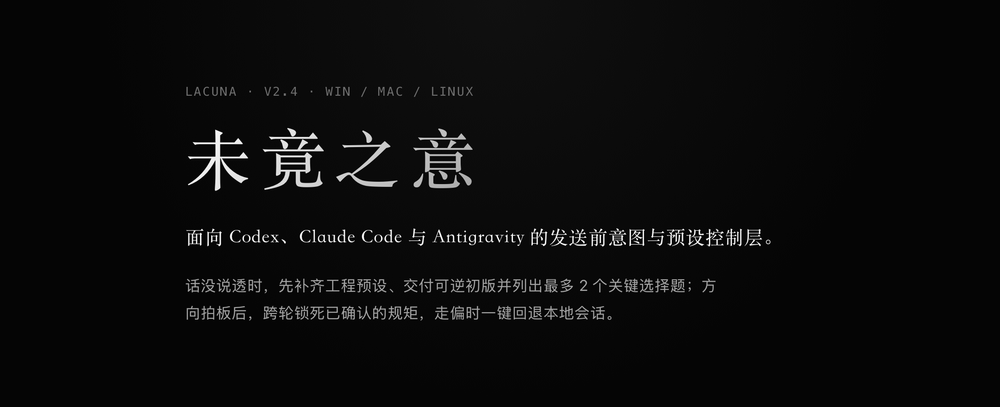

<div align="right">
  <strong>中文</strong> &nbsp;·&nbsp; <a href="./README.en.md">English</a>
</div>



## 安装

`Node.js >= 20` · Windows / macOS / Linux · 支持 Antigravity、Codex（CLI 与桌面端 App）、Claude Code（直接复用本机已登录会员，免填 API Key）

```bash
npm i -g jyl201210-lab/weijingzhiyi-lacuna && lacuna init
```

```powershell
# Windows PowerShell
irm https://raw.githubusercontent.com/jyl201210-lab/weijingzhiyi-lacuna/main/i.ps1 | iex
```

```bash
# macOS / Linux
curl -fsSL https://raw.githubusercontent.com/jyl201210-lab/weijingzhiyi-lacuna/main/i.sh | sh
```

Codex 桌面端 App 可在应用内对话直接发送上方 `npm` 命令安装，完成后完全退出并重启一次 App。

## 使用

- **本分顺手的场外把脉**：当前在哪个软件里聊天，默认就直接调用该软件自己已登录的会员模型在发消息前把脉一次（无后台二次暗调），并在顶部提示与状态查看里亮明本次出场的模型与作用；超时或当期额度用满时如实说明并自动暂走本地基础规则。
- **连发消息合拢与长对话脉络常青**：主 AI 开口前连续发出的多句短话自动合拢成完整一轮意思；半途接入老会话也能从本地记录续接纯净人机问答脉络与你交底过的真实背景（如哪些模块在研、哪些只是演示占位），滤掉大段读取日志噪音，聊到几十轮依然清楚来龙去脉。
- **高级选配多模型会审**：电脑同时登录多家软件会员时，可按需手动开启 `lacuna cross-review on`，由主审与副审并行协作并在界面透明亮出。
- **三档用量自由切换**：支持 `standard`（标准高配档）、`light`（轻量按需档）、`quiet`（静默省流档，零模型调用）。
- **顺着老项目底子干活与切枝恢复**：新建项目给足成熟参考，改动老项目优先沿用既有界面风格与账目精度表结构；支持保存全局长期约定，以及备份切出或无损分叉（`rebase` / `fork`）跑偏轮次并保留原话。

```bash
lacuna status                       # 查看当前软件会员通道、档位、最近调用明细与挂载状态
lacuna tier standard|light|quiet    # 切换消耗档位（标准高配 / 轻量按需 / 静默省流）
lacuna cross-review on|off|status   # 按需开关跨软件多模型会审（默认关闭）
lacuna rules list                   # 查看全局长期约定（支持 add / revoke / clear）
lacuna rebase <session_id> [turns]  # 备份并切掉最后 N 轮跑偏对话（保留原话）
lacuna fork <session_id> [turns]    # 无损分叉出干净新会话
lacuna uninstall                    # 移除接入配置
```

内置前端层次与交互、数据库事务锁、账目精度保护与分位精算、科研统计独立检验、原稿保真整理与商业权责审视经验卡，仅在实际动手做对应事情时递送；你的本轮明确指令始终优先。

## 关于

v3.5 (3.5.0) · 闭源单文件 CLI · `UNLICENSED` · [1061790014@qq.com](mailto:1061790014@qq.com) · WeChat `Jyl2012111`
