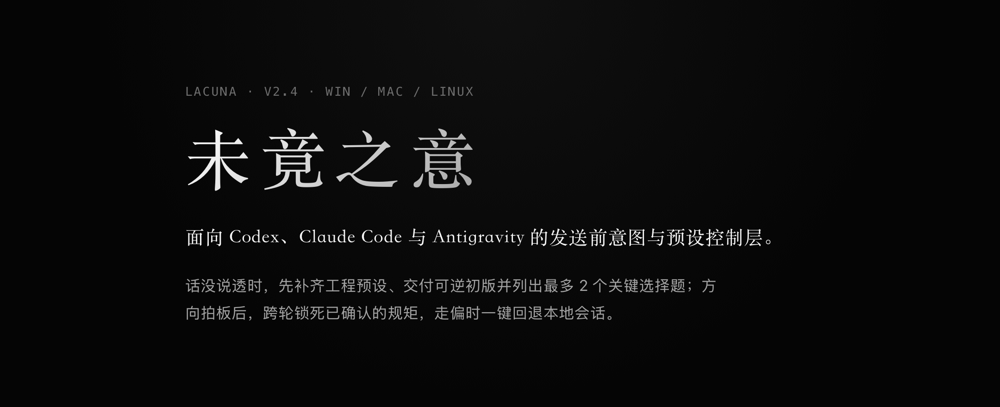

<div align="right">
  <strong>中文</strong> &nbsp;|&nbsp; <a href="./README.en.md">English</a>
</div>

# 未竟之意 · Lacuna `v2.4`
**发送前意图与预设控制器（适配 Codex CLI & 桌面端 / Claude Code / Antigravity · 支持 Windows / macOS / Linux · 中英自动切换）**



---

## 一、 一句话讲清楚：这是什么、解决什么痛点？

平时用 Codex、Claude Code 写代码、做页面、跑科研数据分析时，最常遇到 **3 个憋屈时刻**：

1. **第一轮话没说透，模型要么瞎猜做成廉价模板，要么连问十几个问题烦死你**：
   - 你说“做个记账页”或“跑一下这批样品复核”，没细说配色、字体和事务锁。模型要么直接糊一个廉价蓝紫渐变模板、金额小数点上下乱跳、擅自建三四张关联表；要么一行代码没写先抛十几个问题卡住你。
2. **聊了十几轮，前面定好的规矩它给忘了**：
   - 你在第 2 轮明明拍板说“只用单张表”或“保留历史记录不要物理删”，到了第 5 轮修并发 Bug 时，它顺手又给你改丢了。
3. **一旦走偏，你在对话里越骂“不对”，它顺着旧代码越陷越深**：
   - 因为上一轮写错的几百行代码还留在会话历史里，模型顺着旧上下文打补丁，很难拉回来；可如果重开新会话，前面定好的规矩又得从头交代一遍。

**未竟之意（Lacuna）做的事只有三件（全部在把你的话发给模型之前本地完成，你的明确要求永远排第一，随时一句话覆盖）**：

1. **自动补齐三大领域的具体好习惯（预设库）**：
   - **写界面时**：自动加上数字等宽对齐（`tabular-nums`）、`4px/8px` 间距阶梯、空状态 / 加载防连点 / 报错保留已填内容，按场景匹配克制底色（告别廉价蓝紫渐变）；
   - **写后端与数据时**：自动加上“批量改删先锁明确记录 ID 快照、比对受影响行数”；检测到 `SQLite` 才挂载 `BEGIN IMMEDIATE` 写锁与整数分存储；
   - **做科研统计时**：自动加上“防循环论证（不拿筛选分群用过的变量回同一批数据自证显著性）”、“混杂剥离报告效应量变化”；检测到单细胞 `scRNA-seq` 时按批次 `MAD` 动态质控，不盲套 `5%` 硬删细胞。
2. **第一轮“先交付可逆初版 + 末尾只问 2 个关键选择题”**：
   - 需求还没说死时，先按安全、可逆的默认方案把能跑的第一版交出来；同时在代码结束后用大白话问你最多 **2 个真正决定后续走向的选择题**（比如：*结清是直接物理删旧账，还是改状态留底？*），让你看着跑起来的东西把真实意图定下来。
3. **记住你拍板的规矩 + 走偏时一键物理截断旧记录（`lacuna rebase`）**：
   - 你拍板的选择（含“不要物理删除”等否定要求）会写进本会话的固定规矩清单，后续每一轮修 Bug 都自动带上；如果发现前面某轮走偏了，直接把本地 `.jsonl` 会话文件截断退回到走偏前那一轮（自动备份原文件），带着已锁定的规矩干净重跑。

---

## 二、 30 秒一行安装（Windows / macOS / Linux）

前置要求：本机已安装 `Node.js >= 20`。默认按输入语言自动切换中英文——**全英文提问时自动挂载 100% 纯英文预设与指令（零中文字符混入）**。

### 1. 跨平台通用命令（Windows PowerShell / CMD / macOS / Linux）
```bash
npm i -g jyl201210-lab/weijingzhiyi-lacuna && lacuna init
```

### 2. 系统原生脚本
- **Windows (PowerShell)**：
  ```powershell
  irm https://raw.githubusercontent.com/jyl201210-lab/weijingzhiyi-lacuna/main/i.ps1 | iex
  ```
- **macOS / Linux / WSL**：
  ```bash
  curl -fsSL https://raw.githubusercontent.com/jyl201210-lab/weijingzhiyi-lacuna/main/i.sh | sh
  ```

### 3. Codex 桌面端 App（Windows / macOS）直接让内置 AI 代装
如果使用桌面版 Codex App，直接把下面这句话发给对话框里的 AI，装完后**彻底退出并重启一次 Codex App**（首次发消息若询问本地 Hook 信任，点一次 **Trust / Allow** 即可）：

```text
Please check if Node.js (>=20) is installed (install LTS if missing), then run `npm i -g jyl201210-lab/weijingzhiyi-lacuna && lacuna init` and verify with `lacuna self-test`.
```

---

## 三、 四模型交叉审视与同口径实测对照

在同一道模糊需求任务（*“帮我写一个单文件 HTML 工作台，用来管理实验室样品的异常复核与批量归档结清”*）下，固定相同推理档位（`xhigh`）进行的 Raw 裸跑 vs 挂载未竟之意同口径对照：

| 模型 | 模式 | 等宽数字 `tabular-nums` | 明确暖纸 / 精密色板（无蓝紫渐变模板） | 键盘 `:focus-visible` 与防连点状态 | 批量结清按「快照 ID 集合」加锁防误吞 | 首轮末尾主动给出 2 个关键选择题 |
| :--- | :--- | :---: | :---: | :---: | :---: | :---: |
| **GPT-6 Astra** (`xhigh`) | Raw 裸跑 | 1 | **0** | 1 | **0** | **0** |
| **GPT-6 Astra** (`xhigh`) | **挂载未竟之意** | **1** | **1** | **1** | **1** | **1** |
| **GPT-5.6 Sol** (`xhigh`) | Raw 裸跑 | 1 | **0** | **0** | **0** | **0** |
| **GPT-5.6 Sol** (`xhigh`) | **挂载未竟之意** | **1** | **1** | **1** | **1** | **1** |

在真实 `codex` CLI（`gpt-6-astra`, `xhigh + multi_agent`）与真实 `claude` CLI（`claude-opus-5-5`, `xhigh`）的 **3 轮连续对话 + 并发插单压测**中：
- 两个客户端在第 1 轮交出可用代码的同时，均在代码块外清晰列出了表结构与历史留存的二选一问题；
- 在第 3 轮并发插单压测（结清 `100 + 50` 期间插入新单 `30`）中，均使用 `BEGIN IMMEDIATE` + 快照 ID 集合精准核销，全程未破坏第 2 轮拍板锁定的单表与留存规矩。

---

## 四、 预设优先级与日常调整命令

严格的优先级顺序（绝不越权改你的主意）：
> **1. 你本轮明确提出的要求** > **2. 数据安全与统计有效底线（首轮可逆默认）** > **3. 本会话已拍板锁定的决定** > **4. 检测命中技术栈的条件预设** > **5. 默认审美与工程基线**

安装后平时无需干预，需要时可随时用 `lacuna` 命令查看或调整：

```bash
lacuna help                                      # 查看中英双语命令说明
lacuna config show                               # 查看当前生效的设置
lacuna config set lang en                        # 语言：auto（默认按输入自动识别）| zh | en
lacuna config set visual.default warm-editorial  # 固定默认界面风格（精密深色 / 温暖纸感 / 高对比工具流）
lacuna rules list                                # 查看当前会话已锁定的拍板规矩
lacuna rules revoke --id r_1                     # 撤销某条已锁定规矩
lacuna rebase <session_id> 1                     # 自动备份并物理截断最近 1 轮走偏的 .jsonl 记录
lacuna self-test                                 # 运行跨平台与中英双语自检
lacuna uninstall                                 # 一键卸载全局前置 Hook
```

---

## 五、 发行说明与联系方式

本仓库提供未竟之意（Lacuna）闭源单文件 CLI 发行包（协议：`UNLICENSED`，保留所有权利），不含内部完整开发源码与未封装预设文件。

使用反馈或交流合作欢迎联系：
- **Email**：`1061790014@qq.com`
- **WeChat**：`Jyl2012111`
- **GitHub**：[jyl201210-lab](https://github.com/jyl201210-lab)
